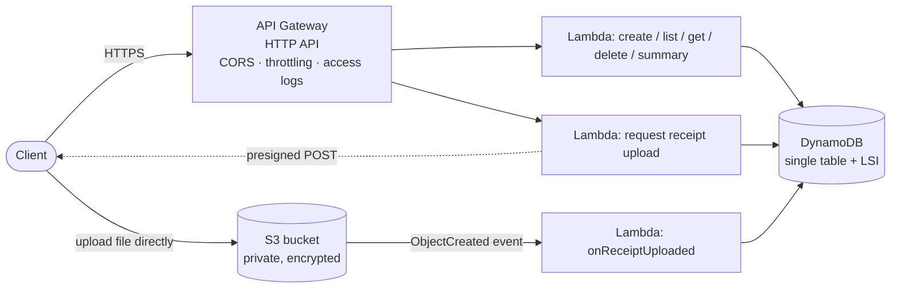

# SpendWise: a serverless expense tracker API on AWS

[](https://github.com/Stuart-Vision/spendwise/actions/workflows/ci.yml)

A REST API for tracking expenses with receipt uploads. It is built entirely from AWS serverless services and defined as infrastructure as code with **AWS SAM**.

**API Gateway** (HTTP API) · **AWS Lambda** (Node.js 22, TypeScript) · **DynamoDB** · **S3** · **CloudWatch** · **X-Ray**



## Endpoints

| Method | Path | Lambda | |
| --- | --- | --- | --- |
| `POST` | `/expenses` | createExpense | Create. An optional `Idempotency-Key` header makes retries safe |
| `GET` | `/expenses?month=YYYY-MM` | listExpenses | One month, newest first |
| `GET` | `/expenses/{id}` | getExpense | Includes a short-lived download link once a receipt is uploaded |
| `DELETE` | `/expenses/{id}` | deleteExpense | Also removes the receipt file |
| `POST` | `/expenses/{id}/receipt` | requestReceiptUpload | Returns a presigned S3 upload form |
| `GET` | `/summary?month=YYYY-MM` | summary | Totals per currency and category |
| S3 event | `receipts/*` created | onReceiptUploaded | Marks the receipt as uploaded |

Errors share one shape: `{"error": {"code": "invalid_request", "message": "amountCents: Number must be greater than 0"}}`.

## Design decisions

| Concern | Approach |
| --- | --- |
| **One function per route** | Each Lambda gets only the IAM permissions it needs. For example, `listExpenses` can only *read* the table, and only `deleteExpense` may delete files. |
| **File uploads bypass Lambda** | The API returns a **presigned S3 POST**. The browser uploads straight to S3, so file bytes never pass through API Gateway (which limits request size) or Lambda (which you pay for per millisecond). S3 itself enforces the 5 MB limit and the content type in the signed policy. |
| **Event-driven confirmation** | An S3 `ObjectCreated` event triggers `onReceiptUploaded`, so the client never has to call back to say the upload finished. Stale or foreign keys are ignored with a DynamoDB condition. |
| **DynamoDB single-table design** | `pk = USER#<id>` and `sk = EXP#<id>`. Every query stays inside one user's partition, so users cannot see each other's data. A **local secondary index** on `date` serves "expenses for a month" with `begins_with`, and it allows **strongly consistent** reads, which a GSI does not. Pagination follows `LastEvaluatedKey`. |
| **Idempotent creates** | The `Idempotency-Key` is hashed into the expense id, and the put has the condition `attribute_not_exists`. Five identical requests at once create exactly one expense; the retries get the original back (`200` with `idempotent-replayed: true`). |
| **Validation** | Zod schemas with `.strict()`, so unknown fields such as a forged `userId` are rejected. Money is integer cents, and dates are checked to be real calendar dates. |
| **Authentication** | Handlers read the user from a **Cognito JWT authorizer** (`claims.sub`) when one is attached. Without one (in this demo) they read an anonymous `X-User-Id` header. Adding a Cognito user pool and authorizer to the template is the next step. |
| **Operations** | API Gateway throttling (burst 50, rate 20/s) and JSON access logs; one structured JSON log line per Lambda invocation for CloudWatch Logs Insights; X-Ray tracing; Graviton (arm64) functions. |
| **Data safety** | DynamoDB point-in-time recovery and encryption at rest. The S3 bucket blocks all public access and encrypts objects. |

## Tests

`npm test` runs the handlers with real **API Gateway HTTP API (payload 2.0) events** against **dynalite**, an in-memory DynamoDB. The table has the same keys and index as `template.yaml`. The tests cover:

- create, read, list by month (newest first) and delete
- **user isolation**: another user gets `404` on read, delete and upload, and sees an empty list
- **idempotency**: 5 concurrent identical requests produce 1 expense
- validation: negative or fractional amounts, unknown currency, 30 February, unexpected fields, malformed JSON, a missing user
- the receipt flow: the presigned policy (key, size limit, type) and the S3 event marking the receipt uploaded, then a signed download link; stale or foreign S3 keys are ignored
- monthly totals that never mix currencies

To check that the idempotency test can fail, the `attribute_not_exists` condition was removed and the suite re-run: the test **fails**.

The bundles that `sam build` produces were also run directly through the full flow, from create to delete. This caught a real problem: the first ESM bundle crashed with `Dynamic require of "node:https" is not supported`, so the functions are now bundled as CommonJS.

CI runs typecheck, the tests, `sam validate --lint` and `sam build` on every push.

## Run it locally

```bash
npm install
npm test
npm run dev        # API on http://localhost:3000, with an in-memory DynamoDB

curl -X POST localhost:3000/expenses \
  -H "x-user-id: 6f1c1a52-2b0e-4b0a-9c55-6a7f1f3a1b11" -H "content-type: application/json" \
  -d '{"amountCents":1250,"currency":"SGD","category":"food","description":"Laksa","date":"2026-10-22"}'
```

Receipt upload links are signed locally, but actually uploading a file needs a real S3 bucket.

## Deploy to AWS

You need an AWS account and the [SAM CLI](https://docs.aws.amazon.com/serverless-application-model/latest/developerguide/install-sam-cli.html).

```bash
sam build
sam deploy --guided      # first time; afterwards just `sam deploy`
```

The stack outputs `ApiUrl`. Everything fits in the AWS Free Tier for personal use (pay-per-request DynamoDB, Lambda and HTTP API). Remove it with `sam delete`.

There is also a **Deploy** workflow (`.github/workflows/deploy.yml`) that deploys from GitHub Actions. It uses OIDC to assume an IAM role, so no AWS keys are stored in GitHub.

## Layout

```
template.yaml            API Gateway, 7 Lambdas, DynamoDB table, S3 bucket, IAM, logs
src/handlers/            one file per Lambda
src/lib/http.ts          response/error handling, auth, structured logs
src/lib/expenses.ts      DynamoDB access (single table, LSI, conditions, pagination)
src/lib/receipts.ts      S3 presigned POST/GET
scripts/dev.ts           local API: HTTP -> API Gateway events -> handlers
test/api.test.ts         handler tests against dynalite
```
